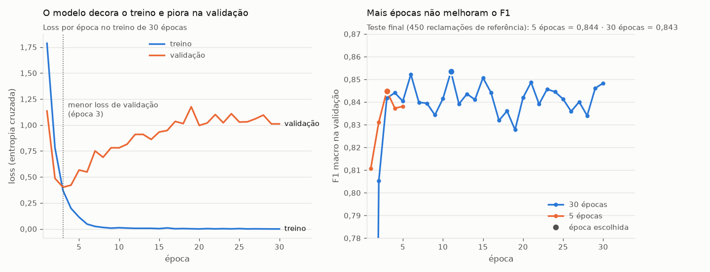

# Destilação de LLM para triagem de reclamações

Um LLM de 550B parâmetros rotula reclamações reais de clientes em 7 categorias de problema; um BERTimbau de 110M parâmetros é treinado nesses rótulos e entrega **90% da qualidade do LLM, ~110× mais rápido e ~600× mais barato**. Modelo publicado no Hugging Face.

[](https://github.com/krosct/project-nov26-p4-destilacao/actions/workflows/ci.yml) · [Modelo no Hugging Face](https://huggingface.co/trebuchetly/bertimbau-triagem-reclamacoes)

## O problema

Com centenas de milhões de pedidos por mês, uma plataforma de delivery ou e-commerce recebe um volume enorme de reclamações que precisam ser roteadas para a fila certa (logística, qualidade, financeiro...). Um LLM grande classifica bem, mas cada chamada custa dinheiro e segundos. **Dá para trocar por um modelo pequeno, rodando em CPU, sem perder muita qualidade?**

## Resultados

Avaliação em **450 reclamações de referência**, separadas antes de tudo e nunca usadas em treino, validação ou ajuste de prompt.

| Modelo | F1 macro | Acurácia | Kappa | Latência p50 | Custo / 1M reclamações |
|---|---|---|---|---|---|
| LLM professor — Nemotron 3 Ultra 550B (API) | 0,942 | 0,951 | 0,941 | 3.742 ms | US$ 1.086 (uma por chamada) · US$ 308 (lotes de 20) |
| **BERTimbau aluno — 110M (CPU)** | **0,844** | **0,876** | **0,850** | **35 ms** | **US$ 1,79** |
| TF-IDF + regressão logística (CPU) | 0,765 | 0,798 | 0,757 | 0,4 ms | — |

- O aluno recupera **90% do F1 do professor** (0,844 / 0,942) e fica **8 pontos acima** do baseline clássico.
- Latência (mediana) medida uma reclamação por vez, nas mesmas 100 reclamações sorteadas da referência para os três modelos, num Intel Core 5 120U com 2 threads; custo do LLM pelo preço da versão paga do mesmo modelo (US$ 0,60/US$ 2,40 por milhão de tokens de entrada/saída, consultado em 03/11/2026); custo da CPU assumindo US$ 0,10/h e a vazão medida em lotes de 32 sobre as 450 da referência (56 mil reclamações/hora). Medições locais variam com a carga da máquina: em execuções seguidas, a latência do BERTimbau ficou entre 35 e 54 ms. Premissas em [`reports/latencia_custo.json`](reports/latencia_custo.json).


Os erros se concentram nas classes menores e mais vagas: `atraso_ou_entrega` (recall 0,71; confundida com `outro` e `atendimento_ou_cobranca`), `outro` (0,73) e `atendimento_ou_cobranca` (0,77). Nas quatro classes principais o recall fica entre 0,86 e 0,98. A confusão mais frequente é `defeito_ou_qualidade` → `produto_errado` (10 de 81): reclamações como "material fino, diferente da foto" ficam na fronteira das duas classes, e o próprio professor erra 7 delas da mesma forma.

## Como funciona


1. **Taxonomia** ([`data/taxonomia.md`](data/taxonomia.md)): 7 classes com definição, exemplo e ordem de desempate. O mesmo documento guia a rotulação de referência e é o prompt do LLM — os dois seguem a mesma régua.
2. **Professor** ([`rotular.py`](src/project_nov26_p4_destilacao/rotular.py)): 20 reclamações por requisição (323 requisições para 6.450 textos), saída validada com Pydantic — rótulo dentro da taxonomia e **exatamente os mesmos números enviados**, porque em lote o LLM às vezes pula ou repete itens e os rótulos ficariam desalinhados sem erro aparente. Cache em disco e 5 lotes em paralelo.
3. **Aluno** ([`scripts/finetune.py`](scripts/finetune.py)): `neuralmind/bert-base-portuguese-cased`, lr 2e-5, lote 16, 128 tokens, fp16 numa GPU de 4 GB (pico de 2,2 GB). O melhor checkpoint é escolhido pelo F1 na validação.
4. **Baseline** ([`scripts/baseline.py`](scripts/baseline.py)): TF-IDF com unigramas e bigramas ("não chegou", "veio errado") e `class_weight="balanced"`.

## Como rodar

```bash
uv sync --group train
cp .env.example .env.shared                               # preencha OPENROUTER_API_KEY (e HF_TOKEN para publicar)
uv run --group train python scripts/pipeline.py           # tudo, em ordem (requer data/raw, ver data/README.md)
```

O pipeline roda `amostrar` → `rotular` (professor) → `baseline` (TF-IDF) → `finetune` (BERTimbau, GPU recomendada) → `figuras` → `latencia` → `testes`, e para na primeira etapa que falhar. Opções: `--de rotular` / `--ate finetune` para rodar só um trecho, `--epocas` e `--batch` para o fine-tuning, `--publicar` para enviar o modelo ao Hugging Face. Cada etapa também pode ser rodada sozinha (`uv run --group train python scripts/<etapa>.py`). Respostas do LLM ficam em cache: repetir a rotulação sem mudar textos nem prompt não gasta requisições.

Usar o modelo publicado:

```python
from transformers import pipeline

clf = pipeline("text-classification", model="trebuchetly/bertimbau-triagem-reclamacoes")
clf("Comprei 2 unidades e só veio uma na caixa.")
# [{'label': 'pedido_incompleto', 'score': 0.994}]
```

## Decisões e trade-offs

- **Referência separada do treino e do ajuste:** o prompt do professor não foi iterado contra a referência; se fosse, ela deixaria de ser teste. Pelo mesmo motivo, o número de épocas foi escolhido na validação.
- **Época escolhida na validação:** em 5 épocas, o F1 de validação foi 0,811 → 0,831 → **0,845** → 0,837 → 0,838, e a loss de validação voltou a subir depois da época 2 (início de overfitting). O checkpoint da época 3 é o usado. Um treino de 30 épocas confirmou o limite: a validação oscilou entre 0,83 e 0,85 sem tendência de alta, a loss de treino foi a ~0 (memorização) enquanto a de validação passou de 1,0, e o F1 na referência ficou igual (0,843 contra 0,844). 5 épocas bastam; o registro está em [`reports/bertimbau_30ep.json`](reports/bertimbau_30ep.json).

  
- **Encoder em vez de LLM para classificar:** o BERT lê o texto inteiro uma vez e uma camada linear decide — não precisa gerar texto. Isso explica os 35 ms em CPU.
- **Lotes no professor:** 3,5× mais barato que uma reclamação por chamada (o prompt com a taxonomia é pago uma vez a cada 20 textos), com concordância de 95% na referência.
- **Kappa e F1 macro, não só acurácia:** `nao_recebido` sozinha é 26% da referência; o kappa desconta o acerto por acaso e o F1 macro dá o mesmo peso às classes pequenas.

## Limitações e próximos passos

- **Domínio:** reclamações de e-commerce. Em delivery de comida, entrega e qualidade têm outros padrões (comida fria, item trocado); seria preciso reavaliar e, provavelmente, novos rótulos.
- **Uma classe por texto:** reclamações com vários problemas recebem só o principal; multirrótulo é o passo natural.
- **Ruído do professor:** o aluno herda os erros do LLM; na referência o professor erra 22 de 450, sobretudo entre `defeito_ou_qualidade` e `produto_errado`.
- **Referência:** 450 exemplos, com no mínimo 30 por classe, rotulados por um único anotador; os intervalos de confiança por classe ainda são largos para as menores.
- Próximos experimentos: curva de quantidade de rótulos (500 / 1.000 / 3.000 / 6.000), LoRA num LLM pequeno e calibração da confiança para mandar casos incertos ao LLM (arquitetura em cascata).
