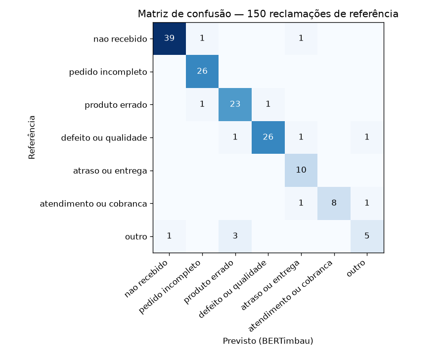
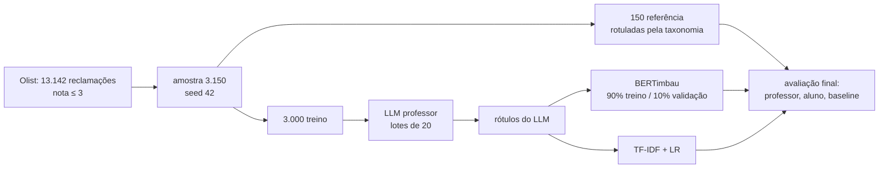

# Destilação de LLM para triagem de reclamações

Um LLM de 550B parâmetros rotula reclamações reais de clientes em 7 categorias de problema; um BERTimbau de 110M parâmetros é treinado nesses rótulos e entrega **90% da qualidade do LLM, ~100× mais rápido e ~465× mais barato**. Modelo publicado no Hugging Face.

[](https://github.com/krosct/project-nov26-p4-destilacao/actions/workflows/ci.yml) · [Modelo no Hugging Face](https://huggingface.co/trebuchetly/bertimbau-triagem-reclamacoes)

## O problema

Com centenas de milhões de pedidos por mês, uma plataforma de delivery ou e-commerce recebe um volume enorme de reclamações que precisam ser roteadas para a fila certa (logística, qualidade, financeiro...). Um LLM grande classifica bem, mas cada chamada custa dinheiro e segundos. **Dá para trocar por um modelo pequeno, rodando em CPU, sem perder muita qualidade?**

## Resultados

Avaliação em **150 reclamações de referência**, separadas antes de tudo e nunca usadas em treino, validação ou ajuste de prompt.

| Modelo | F1 macro | Acurácia | Kappa | Latência p50 | Custo / 1M reclamações |
|---|---|---|---|---|---|
| LLM professor — Nemotron 3 Ultra 550B (API) | 0,970 | 0,980 | 0,976 | 3.628 ms | US$ 1.115 (uma por chamada) · US$ 304 (lotes de 20) |
| **BERTimbau aluno — 110M (CPU)** | **0,875** | **0,913** | **0,894** | **36 ms** | **US$ 2,40** |
| TF-IDF + regressão logística (CPU) | 0,745 | 0,793 | 0,747 | 0,4 ms | — |

- O aluno recupera **90% do F1 do professor** e fica **13 pontos acima** do baseline clássico.
- Latência medida uma reclamação por vez num Intel Core 5 120U com 2 threads; custo do LLM pelo preço da versão paga do mesmo modelo (US$ 0,60/US$ 2,40 por milhão de tokens de entrada/saída, consultado em 03/11/2026); custo da CPU assumindo US$ 0,10/h e a vazão medida (34 mil reclamações/hora). Premissas em [`reports/latencia_custo.json`](reports/latencia_custo.json).



Os erros se concentram nas classes menores e mais vagas: `outro` (recall 0,56; confunde com `produto_errado`) e `atendimento_ou_cobranca` (0,80). As quatro classes principais ficam entre 0,90 e 1,00.

## Como funciona



1. **Taxonomia** ([`data/taxonomia.md`](data/taxonomia.md)): 7 classes com definição, exemplo e ordem de desempate. O mesmo documento guia a rotulação de referência e é o prompt do LLM — os dois seguem a mesma régua.
2. **Professor** ([`rotular.py`](src/project_nov26_p4_destilacao/rotular.py)): 20 reclamações por requisição (158 requisições para 3.150 textos), saída validada com Pydantic — rótulo dentro da taxonomia e **exatamente os mesmos números enviados**, porque em lote o LLM às vezes pula ou repete itens e os rótulos ficariam desalinhados sem erro aparente. Cache em disco e 5 lotes em paralelo.
3. **Aluno** ([`scripts/finetune.py`](scripts/finetune.py)): `neuralmind/bert-base-portuguese-cased`, lr 2e-5, lote 16, 128 tokens, fp16 numa GPU de 4 GB (pico de 2,2 GB). O melhor checkpoint é escolhido pelo F1 na validação.
4. **Baseline** ([`scripts/baseline.py`](scripts/baseline.py)): TF-IDF com unigramas e bigramas ("não chegou", "veio errado") e `class_weight="balanced"`.

## Como rodar

```bash
uv sync --group train
echo "OPENROUTER_API_KEY=..." > .env
uv run python scripts/amostrar.py                         # amostra (requer data/raw, ver data/README.md)
uv run python scripts/rotular_llm.py                      # professor: referência + treino
uv run python scripts/baseline.py                         # TF-IDF
uv run --group train python scripts/finetune.py           # BERTimbau (GPU recomendada)
uv run --group train python scripts/latencia.py           # latência e custo
```

Usar o modelo publicado:

```python
from transformers import pipeline

clf = pipeline("text-classification", model="trebuchetly/bertimbau-triagem-reclamacoes")
clf("Comprei 2 unidades e só veio uma na caixa.")
# [{'label': 'pedido_incompleto', 'score': 0.987}]
```

## Decisões e trade-offs

- **Referência separada do treino e do ajuste:** o prompt do professor não foi iterado contra a referência; se fosse, ela deixaria de ser teste. Pelo mesmo motivo, o número de épocas foi escolhido na validação.
- **3 × 5 épocas:** com 3 épocas a loss de validação ainda caía (F1 de validação 0,785); com 5, o F1 de validação chegou a 0,837 na época 4 e a loss voltou a subir depois (início de overfitting). O checkpoint da época 4 é o publicado.
- **Encoder em vez de LLM para classificar:** o BERT lê o texto inteiro uma vez e uma camada linear decide — não precisa gerar texto. Isso explica os 36 ms em CPU.
- **Lotes no professor:** 3,7× mais barato que uma reclamação por chamada (o prompt com a taxonomia é pago uma vez a cada 20 textos), com concordância de 98% na referência.
- **Kappa e F1 macro, não só acurácia:** `nao_recebido` sozinha é 27% da referência; o kappa desconta o acerto por acaso e o F1 macro dá o mesmo peso às classes pequenas.

## Limitações e próximos passos

- **Domínio:** reclamações de e-commerce. Em delivery de comida, entrega e qualidade têm outros padrões (comida fria, item trocado); seria preciso reavaliar e, provavelmente, novos rótulos.
- **Uma classe por texto:** reclamações com vários problemas recebem só o principal; multirrótulo é o passo natural.
- **Ruído do professor:** o aluno herda os erros do LLM; na referência o professor erra 3 de 150.
- **Referência pequena:** 150 exemplos dão intervalos de confiança largos para as classes com 9–10 exemplos.
- Próximos experimentos: curva de quantidade de rótulos (500 / 1.000 / 3.000), LoRA num LLM pequeno e calibração da confiança para mandar casos incertos ao LLM (arquitetura em cascata).
